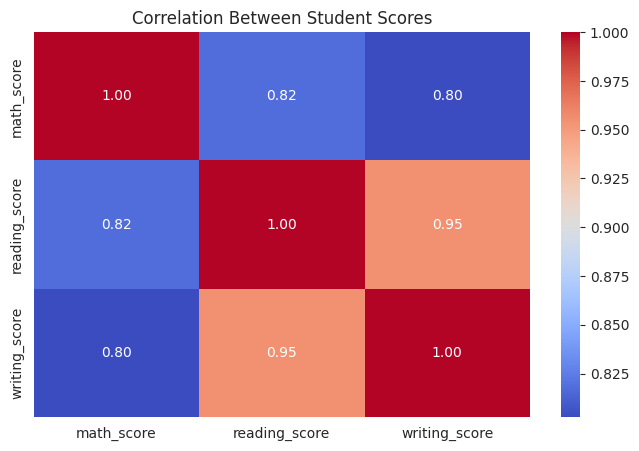
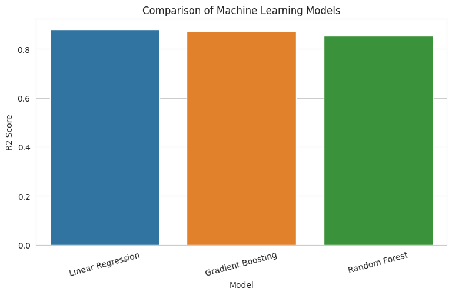
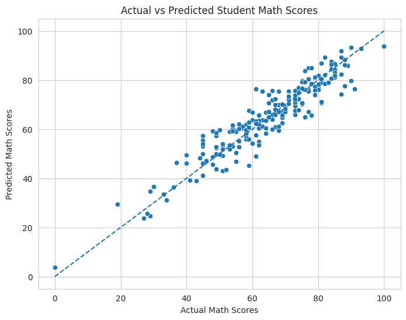
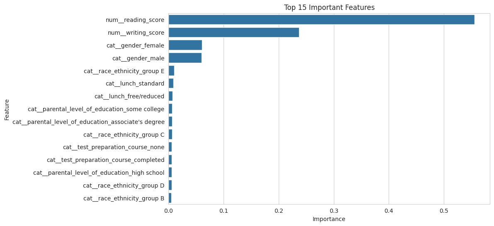

# Student Performance Prediction Using Machine Learning

## Project Overview
This project focuses on analyzing student academic performance and predicting mathematics scores using Machine Learning techniques.

The project uses student demographic and academic information, including gender, parental education, lunch type, test preparation course, reading scores, and writing scores.

## Objectives
- Clean and preprocess student performance data.
- Perform Exploratory Data Analysis (EDA).
- Visualize academic performance patterns.
- Apply Machine Learning regression algorithms.
- Compare model performance using evaluation metrics.
- Predict mathematics scores for new students.

## Dataset
The dataset contains student information and examination scores in three subjects:
- Mathematics
- Reading
- Writing

**Features include:**
- Gender
- Race/Ethnicity
- Parental Level of Education
- Lunch
- Test Preparation Course
- Reading Score
- Writing Score

**Target Variable:** Math Score

## Technologies Used
- Python
- Pandas
- NumPy
- Matplotlib
- Seaborn
- Scikit-learn
- Google Colab

## Project Workflow
1. Data Inspection
2. Data Cleaning
3. Data Preprocessing
4. Exploratory Data Analysis (EDA)
5. Data Visualization
6. Feature Selection
7. Train-Test Split
8. Machine Learning Model Training
9. Model Evaluation
10. Model Comparison
11. Student Performance Prediction

## Machine Learning Algorithms
The following regression algorithms are implemented:
- Linear Regression
- Random Forest Regressor
- Gradient Boosting Regressor

## Model Evaluation
The models are evaluated using:
- Mean Absolute Error (MAE)
- Mean Squared Error (MSE)
- Root Mean Squared Error (RMSE)
- R² Score

The best-performing model is selected based on its evaluation results.

## Prediction
The trained model predicts a student's mathematics score using available student characteristics and reading and writing scores.

**Note:** Reading and writing scores must be available to make predictions using this model.

## How to Run
1. Download or clone this repository.
2. Open Google Colab.
3. Upload the Jupyter Notebook.
4. Run the notebook cells sequentially.

## Author
**Ahmad Khan**

Data Science Graduate | Machine Learning Enthusiast

## Project Status
Completed

## Project Visualizations

## Data Analysis

## Model Comparison

## Actual vs Predicted Results

## Feature Importance

